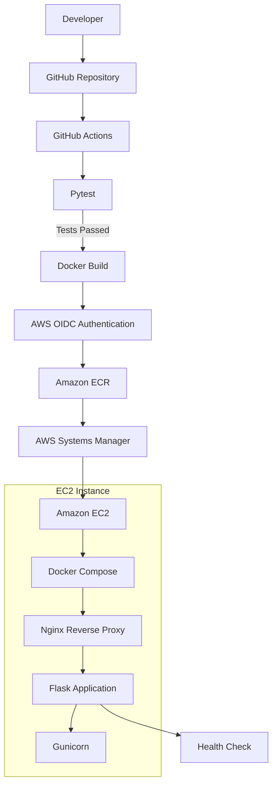

# AWS CI/CD Pipeline – Automated Flask Deployment

<p align="center">

**Automated Cloud Deployment using AWS, Terraform, Docker and GitHub Actions**

</p>

---

## Project Overview

This project implements an automated CI/CD pipeline for a Python Flask application deployed on Amazon EC2.

The pipeline automates application testing, Docker image building, publishing to Amazon Elastic Container Registry (ECR), and deployment to EC2 using AWS Systems Manager (SSM).

GitHub Actions triggers the pipeline automatically whenever code is pushed to the `main` branch.

## Architecture Diagram



## Technologies Used

| Category | Technologies |
|---|---|
| Cloud Provider | Amazon Web Services |
| Infrastructure as Code | Terraform |
| CI/CD | GitHub Actions |
| Authentication | AWS IAM OIDC |
| Containerization | Docker |
| Container Orchestration | Docker Compose |
| Container Registry | Amazon ECR |
| Compute | Amazon EC2 |
| Remote Deployment | AWS Systems Manager |
| Reverse Proxy | Nginx |
| Backend | Python, Flask, Gunicorn |
| Testing | Pytest |
| Version Control | Git and GitHub |

## AWS Services

The project uses the following AWS services:

- Amazon EC2 – Hosts the application.
- Amazon ECR – Stores Docker images.
- AWS IAM – Manages roles and permissions.
- AWS IAM OIDC Provider – Enables secure GitHub authentication.
- AWS Systems Manager – Executes remote deployment commands.
- Amazon VPC – Provides network isolation.
- Public Subnet – Hosts the EC2 instance.
- Internet Gateway – Provides internet connectivity.
- Security Groups – Controls network traffic.
- Amazon CloudWatch – Supports infrastructure monitoring.

## Project Structure

```text
aws-cicd-project/
│
├── .github/
│   └── workflows/
│       └── ci-cd.yml
│
├── app/
│   ├── __init__.py
│   └── app.py
│
├── nginx/
│   └── nginx.conf
│
├── terraform/
│   ├── ec2.tf
│   ├── ecr.tf
│   ├── github-iam.tf
│   ├── iam.tf
│   ├── main.tf
│   ├── networking.tf
│   ├── oidc.tf
│   ├── outputs.tf
│   ├── provider.tf
│   ├── security.tf
│   ├── variables.tf
│   └── versions.tf
│
├── tests/
│   └── test_app.py
│
├── Dockerfile
├── docker-compose.yml
├── requirements.txt
├── requirements-dev.txt
└── README.md
```

## CI/CD Pipeline Workflow

The pipeline consists of the following stages:

### 1. Source Code Management

Developers push application changes to the GitHub repository's `main` branch.

### 2. Automated Testing

GitHub Actions installs the Python dependencies and executes automated tests using Pytest.

```bash
python -m pytest -v
```

The deployment process continues only when the tests pass.

### 3. Docker Image Build

GitHub Actions builds a Docker image using the project's Dockerfile.

The image is tagged using the Git commit SHA to provide version identification.

### 4. AWS Authentication Using OIDC

GitHub Actions authenticates with AWS through OpenID Connect.

This approach eliminates the need to store long-lived AWS access keys in GitHub Secrets.

### 5. Amazon ECR

The newly built Docker image is pushed to the Amazon ECR repository.

### 6. Deployment Using AWS Systems Manager

AWS Systems Manager sends deployment commands to the EC2 instance.

The deployment process:

- Authenticates Docker with Amazon ECR.
- Pulls the latest application image.
- Updates the application container using Docker Compose.
- Checks the application container health status.

### 7. Application Health Verification

The deployment is verified using the application's health endpoint.

## Infrastructure as Code – Terraform

Terraform is used to provision the AWS infrastructure.

Infrastructure components include:

- VPC
- Public Subnet
- Internet Gateway
- Route Table
- Security Group
- EC2 Instance
- IAM Role and Instance Profile
- Amazon ECR Repository
- GitHub OIDC Identity Provider
- GitHub Actions IAM Role

Terraform commands:

```bash
terraform -chdir=terraform init

terraform -chdir=terraform validate

terraform -chdir=terraform plan

terraform -chdir=terraform apply
```

## Security Implementation

Security practices implemented in this project include:

- GitHub Actions authentication using AWS OIDC.
- IAM roles with controlled permissions.
- No long-lived AWS access keys stored in GitHub repository secrets.
- EC2 management through AWS Systems Manager instead of SSH.
- Security Group rules restricting inbound access.
- Immutable ECR image tags.
- Docker container health checks.

## Application Endpoints

| Endpoint | Description |
|---|---|
| `/` | Returns application information |
| `/health` | Returns application health status |

## Testing Results

Automated application tests were executed successfully.

```text
tests/test_app.py::test_home_endpoint PASSED
tests/test_app.py::test_health_endpoint PASSED

2 passed
```

## Deployment Verification

The application was successfully deployed to Amazon EC2.

The following checks were completed:

- Successful GitHub Actions workflow execution.
- Successful AWS OIDC authentication.
- Successful Docker image build.
- Successful image push to Amazon ECR.
- Successful remote deployment through AWS Systems Manager.
- Successful Docker container health check.
- HTTP 200 response from the application endpoint.
- HTTP 200 response from the health endpoint.

### Application Response

```json
{
  "application": "DevOps Flask Application",
  "environment": "production",
  "message": "Version 2 - Automated CI/CD Deployment!",
  "version": "1.0.0"
}
```

### Health Check Response

```json
{
  "status": "healthy"
}
```

## Key Learning Outcomes

Through this project, I gained practical experience in:

- Designing automated CI/CD pipelines.
- Implementing Infrastructure as Code using Terraform.
- Building and managing Docker containers.
- Integrating GitHub Actions with AWS.
- Implementing secure authentication using OIDC.
- Managing Docker images with Amazon ECR.
- Deploying applications using AWS Systems Manager.
- Configuring Nginx as a reverse proxy.
- Implementing automated application testing.
- Verifying application health after deployment.

## Future Improvements

Potential improvements for future iterations:

- Remote Terraform state management using Amazon S3.
- Infrastructure monitoring and alerting.
- HTTPS using AWS Certificate Manager and a domain.
- Deployment rollback strategy.
- Blue/Green deployment.
- Automated vulnerability scanning for Docker images.

## Author

**Abubaker Abdallh**

B.Tech – Information Technology

Cloud & DevOps Engineering

GitHub: [Abubaker-cloud](https://github.com/Abubaker-cloud)

Project Repository: [AWS CI/CD Project](https://github.com/Abubaker-cloud/aws-cicd-project)

---

**Project Status: Successfully Deployed and Verified**

*Built as a hands-on Cloud and DevOps engineering project.*
